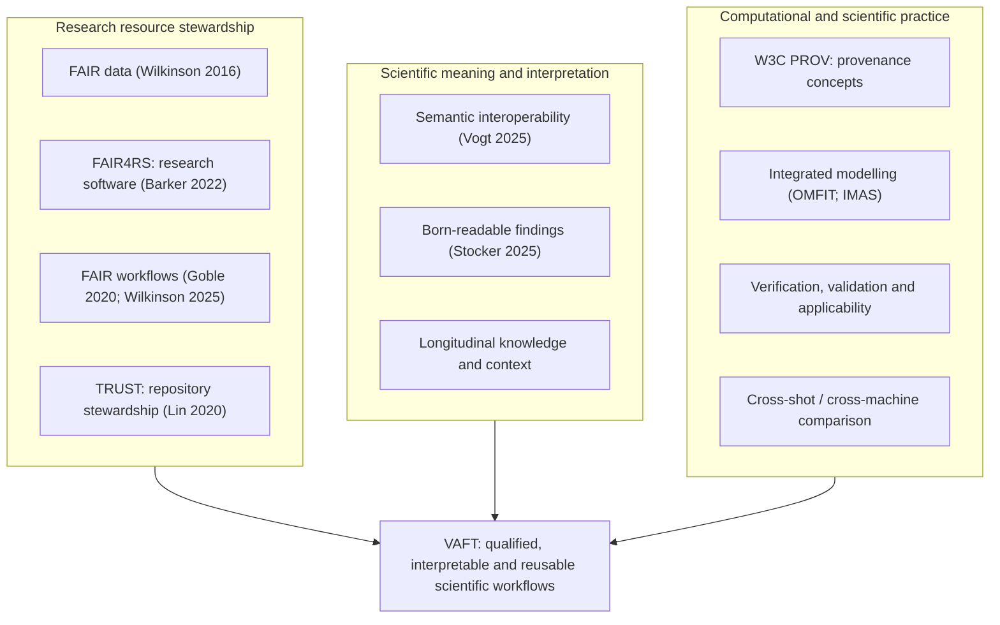
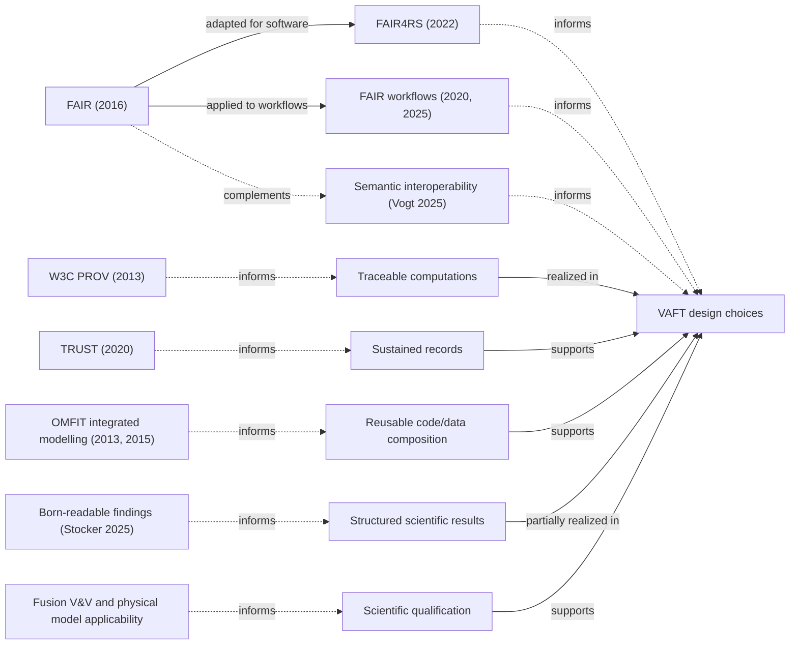

VAFT integrates experimental records, physical models, computation and research practice.
Its design is informed by **several complementary traditions**, not derived from a
single FAIR standard. This page explains those traditions and maps them to
[scientific architecture]({{ '/reference/scientific-architecture/' | relative_url }}),
[computational layers]({{ '/reference/computational-layers/' | relative_url }}),
[scientific credibility]({{ '/reference/credibility-applicability/' | relative_url }})
and inspectable implementations. It is an explanatory guide, **not a certificate of
compliance**, an evidence of universal portability, or a claim of scientific correctness.

The original
[scientific infrastructure principles]({{ '/reference/diagrams/' | relative_url }}#the-vaft-framework-pillars-research-cycle-managed-pipeline-provenance)
diagram deliberately provides a compact two-sided overview: cross-disciplinary FAIR /
PROV / TRUST principles and fusion-community methodological requirements. The first
diagram below is its **expanded documentary interpretation**, not a silent replacement
for the versioned `vaft.diagram.scientific_infrastructure_principles()` asset.

## Reading the relationships

Four relationships must not be conflated:

| Relation | Meaning | Appropriate example |
| --- | --- | --- |
| **Extends / adapts** | One published framework explicitly develops another | FAIR4RS adapts FAIR for research software; workflow FAIR guidance adapts FAIR to executable workflows |
| **Complements** | Independent frameworks address different scientific concerns | FAIR access does not establish numerical validity; V&V addresses different questions |
| **Informs** | An intellectual or methodological precedent motivates a VAFT choice | OMFIT's integration practice informs composition of codes and data, without implying common software architecture |
| **Implemented through** | A specific VAFT component realizes a design mechanism | Registry-defined relations are rendered by the scientific ontology explorer |

A conceptual similarity is not evidence of historical derivation or implementation of
a formal standard. In particular, recording provenance is not the same as serializing
W3C PROV, and making a result machine-readable does not prove its physical validity.

## Expanded scientific-infrastructure principles

The following **documentation-level revision** supplements the compact principles
diagram. Its branches are *complementary concerns*, not a hierarchy of standards;
the convergence on VAFT denotes design influence, not complete compliance.

The expanded view makes **semantic meaning, structured knowledge production, and
long-term contextual recovery** visible rather than treating them as automatic
consequences of FAIRness. See the [four pillars]({{ '/reference/diagrams/' | relative_url }})
for architectural capabilities and the [research domains]({{ '/reference/research-domains/' | relative_url }})
for the modes of scientific use.

## Intellectual and methodological lineages

This second, distinct diagram records only **defensible named relationships**.
Solid labelled edges denote published extensions or adaptations; dotted edges
mean complementary design influences, not ancestry or asserted standards compliance.

The diagrams are authored in this Jekyll page using Mermaid so they can be edited
and reviewed with the associated scientific argument. They are **not** generated
`vaft.diagram` API assets, which require a separate builder/renderer and asset
freshness checks. This division avoids altering a canonical generated SVG without
regenerating it.

## Principle-to-implementation evidence map

Statuses refer to **named mechanisms**, never to overall FAIR / PROV / TRUST
certification. *Implemented* means the linked source or guide explicitly documents
a concrete mechanism; it does not mean it has been independently evaluated for
scientific effectiveness. *Partial* denotes a narrower realization than the
referenced methodological programme. *Context* denotes influence rather than a
software feature.

| Lineage or concern | Design requirement | Implementation evidence | Assessment |
| --- | --- | --- | --- |
| FAIR (Wilkinson et al., 2016) | Discoverable, accessible, interoperable and reusable research data | [Data access and IMAS]({{ '/workflows/data-access-imas/' | relative_url }}); [database sources]({{ '/reference/database-data-sources/' | relative_url }}) | Implemented mechanisms; no complete FAIR audit claimed |
| FAIR4RS (Barker et al., 2022) | Reusable, versioned and documented research software | [Generated API catalog]({{ '/reference/api/' | relative_url }}); [documentation build](https://github.com/VEST-Tokamak/vaft/blob/develop/docs/README.md) | Implemented mechanisms; no principle-by-principle certification |
| FAIR computational workflows (Goble et al., 2020; Wilkinson et al., 2025) | Inspectable executable composition and workflow provenance | [Automated pipelines]({{ '/workflows/automated-pipelines/' | relative_url }}); [pipeline lineage]({{ '/reference/pipeline-graph/' | relative_url }}) | Implemented workflows; FAIR publishing/discovery not fully assessed |
| Provenance (W3C PROV, 2013) | Distinguish inputs, activities, agents, versions and derived products | [Pipeline lineage]({{ '/reference/pipeline-graph/' | relative_url }}); [machine mapping provenance](https://github.com/VEST-Tokamak/vaft/blob/develop/vaft/machine_mapping/provenance.py) | Implemented native records; PROV exchange conformance unverified |
| TRUST (Lin et al., 2020) | Explain access, repository governance and long-term responsibility | [Database and data sources]({{ '/reference/database-data-sources/' | relative_url }}); [contacts]({{ '/reference/contacts/' | relative_url }}) | Partial; trustworthy-repository certification not claimed |
| Semantic interoperability (Vogt et al., 2025) | Explicit concept identity, mapping, relations and unresolved ambiguity | [Ontology explorer]({{ '/reference/ontology/' | relative_url }}); [typed relation generator](https://github.com/VEST-Tokamak/vaft/blob/develop/vaft/_ontology_graph.py) | Implemented typed semantics; no universal semantic equivalence |
| Born-readable scientific findings (Stocker et al., 2025) | Produce structured scientific resources *during* research, including context and evidence | [Ontology]({{ '/reference/ontology/' | relative_url }}); [validation evidence]({{ '/reference/credibility-applicability/' | relative_url }}); [immutable study/run records](https://github.com/VEST-Tokamak/vaft/blob/develop/vaft/process/ml/_experiment_store.py) | **Implemented core production-time approach**; publication-linked findings and external knowledge-graph aggregation unverified |
| Integrated modelling (Meneghini and Lao, 2013; IMAS) | Compose heterogeneous scientific codes and data without conflating methods | [Scientific architecture]({{ '/reference/scientific-architecture/' | relative_url }}); [computational layers]({{ '/reference/computational-layers/' | relative_url }}) | Implemented design and code interfaces; portability depends on device mapping |
| Scientific credibility / V&V | Separate source evidence, transformation, inference, applicability, numerical checks and independent validation | [Credibility and applicability]({{ '/reference/credibility-applicability/' | relative_url }}); [validation taxonomy](https://github.com/VEST-Tokamak/vaft/blob/develop/vaft/validation/credibility.py) | Implemented taxonomy and selected assessments; not a universal physical guarantee |
| Reproducible documentation (Ram, 2013) | Link generated descriptions to source revisions, catch broken relationships | [Documentation build](https://github.com/VEST-Tokamak/vaft/blob/develop/docs/README.md); [diagram guide]({{ '/reference/diagrams/' | relative_url }}) | Implemented for registered catalogs and assets |
| Longitudinal scientific knowledge recovery | Preserve period-dependent machine conventions and explain uncertainty rather than silently rewriting history | [Diagnostics registry]({{ '/reference/vest-diagnostics/' | relative_url }}); [machine mapping]({{ '/reference/imas-concepts/' | relative_url }}) | Implemented selected VEST mappings; archive completeness is a separate measurement |
| Human-readable and machine-accessible interfaces | Expose the same scientific descriptions to people and software agents | [Documentation]({{ '/reference/api/' | relative_url }}); [read-only MCP adapter]({{ '/reference/mcp/' | relative_url }}) | Implemented access mechanism; agent reasoning gains not evaluated |

### What “born-readable” does and does not mean here

Stocker et al.'s **reborn** research programme distinguishes (1) producing
machine-readable expressions of findings while analysis is performed,
(2) depositing the structured findings and connecting them to publications,
and (3) collecting them in knowledge-graph aggregation systems.

VAFT already supports a substantial part of **stage 1**: scientific quantities
and relationships are described in source-controlled registries; analysis
produces IMAS/OMAS data and machine-readable validation artifacts; individual
study workflows can emit structured, content-addressed records. The
[ontology]({{ '/reference/ontology/' | relative_url }}) encodes relations such as
`measures`, `represented_by`, `consumes`, `produces`, `assumes` and
`assessed_by`. The
[experiment store](https://github.com/VEST-Tokamak/vaft/blob/develop/vaft/process/ml/_experiment_store.py)
records linked `study`, `run`, `evaluation`, `decision` and `manifest`
objects for the ML research workflow; that **specific implementation** should
not be generalized to every VAFT workflow.

VAFT does **not thereby demonstrate** a single canonical repository-wide
research-claim object that binds every numerical conclusion to its primary
evidence, nor publication DOI linkage, deposited claims, or ORKG ingestion.
These narrower gaps concern interoperability with the *full reborn publication
lifecycle*, not absence of production-time machine-readable scientific work.

## Why human interpretation still matters

Data-path compatibility, semantic identity, and physical interchangeability
are distinct. A field in the IMAS equilibrium IDS can be numerically loadable
without containing sufficient profile information for downstream MHD
stability analysis. An inferred quantity is not a direct measurement; a
converged calculation can violate its physical model's validity conditions.
Consequently:

- **Data / numerical interoperability** makes representations exchangeable.
- **Semantic interoperability** makes concept identities and relations explicit.
- **Scientific qualification** evaluates evidence, assumptions, scope and
  physical applicability for a particular use.
- **Human and AI interpretability** depends on exposing all three through
  documentation, diagrams, plots, notebooks and bounded agent interfaces.

These are complementary design goals; no one entails the others. The
[ontology explorer]({{ '/reference/ontology/' | relative_url }}),
[credibility taxonomy]({{ '/reference/credibility-applicability/' | relative_url }})
and [MCP interface]({{ '/reference/mcp/' | relative_url }}) expose different
facets of that relationship. Expert review remains necessary when recovering
historical calibration rules or resolving ambiguous scientific conventions.

## Scope and maintenance

This page describes the code and documented behaviour on the branch used to
build it. For a release or manuscript citation, use a **fixed commit or
release**, not a mutable documentation URL alone. Prefer generated source links
and registries over copying implementation details into narrative text. When
a mechanism changes, update its evidence link and assessment here.

The following are **not established** by this page: formal FAIR or TRUST
certification; W3C PROV interchange compatibility; complete historical coverage;
uniform enforcement of provenance for all codes; machine-to-machine portability
without qualified mapping; or demonstrated improvement of agent accuracy or
research productivity.

## Foundational references

These are representative sources, not an asserted single historical genealogy.

- Wilkinson, M. D. et al. (2016). *The FAIR Guiding Principles for scientific data management and stewardship*. [DOI:10.1038/sdata.2016.18](https://doi.org/10.1038/sdata.2016.18).
- Barker, M. et al. (2022). *Introducing the FAIR Principles for research software*. [DOI:10.1038/s41597-022-01710-x](https://doi.org/10.1038/s41597-022-01710-x).
- Goble, C. et al. (2020). *FAIR Computational Workflows*. [DOI:10.1162/dint_a_00033](https://doi.org/10.1162/dint_a_00033).
- Wilkinson, S. R. et al. (2025). *Applying the FAIR Principles to computational workflows*. [DOI:10.1038/s41597-025-04451-9](https://doi.org/10.1038/s41597-025-04451-9).
- W3C (2013). *PROV-DM: The PROV Data Model*. [Recommendation](https://www.w3.org/TR/prov-dm/).
- Lin, D. et al. (2020). *The TRUST Principles for digital repositories*. [DOI:10.1038/s41597-020-0486-7](https://doi.org/10.1038/s41597-020-0486-7).
- Dempsey, W. et al. (2022). *Sharing Begins at Home: How Continuous and Ubiquitous FAIRness Can Enhance Research Productivity and Data Reuse*. [DOI:10.1162/99608f92.44d21b86](https://doi.org/10.1162/99608f92.44d21b86).
- Vogt, L. et al. (2025). *Suggestions for extending the FAIR Principles based on a linguistic perspective on semantic interoperability*. [DOI:10.1038/s41597-025-05011-x](https://doi.org/10.1038/s41597-025-05011-x).
- Stocker, M. et al. (2025). *Rethinking the production and publication of machine-readable expressions of research findings*. [DOI:10.1038/s41597-025-04905-0](https://doi.org/10.1038/s41597-025-04905-0).
- Meneghini, O. and Lao, L. (2013). *Integrated Modeling of Tokamak Experiments with OMFIT*. [DOI:10.1585/pfr.8.2403009](https://doi.org/10.1585/pfr.8.2403009).
- Meneghini, O. et al. (2015). *Integrated modeling applications for tokamak experiments with OMFIT*. [DOI:10.1088/0029-5515/55/8/083008](https://doi.org/10.1088/0029-5515/55/8/083008).
- Ram, K. (2013). *Git can facilitate greater reproducibility and increased transparency in science*. [DOI:10.1186/1751-0473-8-7](https://doi.org/10.1186/1751-0473-8-7).
